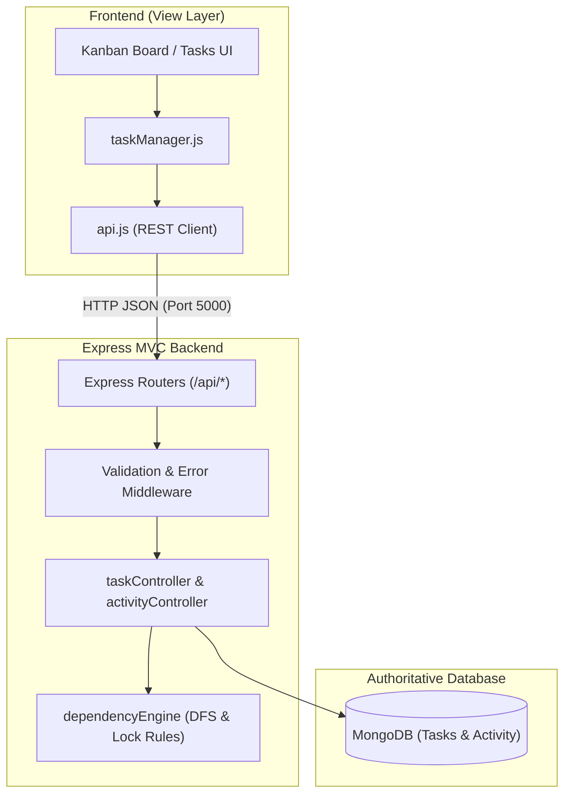

# FlowLock — Local Full-Stack Upgrade

FlowLock is a dependency-aware task management application and Kanban board featuring graph cycle detection, algorithmic lock propagation, and workflow anti-cheat rules.

This upgrade transforms the original client-only frontend into a decoupled, production-grade full-stack architecture backed by Node.js, Express.js, and MongoDB (via Mongoose).

---

## 1. Project Architecture

FlowLock separates concerns into a clean Model-View-Controller (MVC) pattern:

- **View Layer (`frontend/`)**: Pure semantic HTML5, modern responsive CSS3, and vanilla ES6 modules. Preserves all original UI layouts, theme preferences, session guards, and interactive Kanban behaviors without introducing heavyweight UI frameworks.
- **Client API Layer (`frontend/js/api.js`)**: Centralized HTTP client handling RESTful communication with the Express backend, normalizing errors, parsing JSON, and maintaining connection resiliency.
- **Controller & Business Logic (`express/controllers/`, `express/services/`)**: Enforces task validation, DFS cycle detection, lock recalculation, and status transition rules independently on the server.
- **Data Access & Storage (`express/models/`, `express/config/`)**: Mongoose schemas defining models for Tasks and Activities, persisting data to MongoDB.



---

## 2. Directory Structure

```text
FlowLock-Local/
├── frontend/                     # Preserved frontend view layer
│   ├── activity.html             # Real-time activity timeline
│   ├── dashboard.html            # Main Kanban board & metrics
│   ├── index.html                # Product landing page
│   ├── login.html                # User login experience
│   ├── profile.html              # User profile & session details
│   ├── signup.html               # Registration experience
│   ├── styles.css                # Global design system & theme styling
│   ├── tasks.html                # Filterable tasks table view
│   ├── docs/                     # Project technical documentation
│   └── js/
│       ├── api.js                # Centralized REST API client
│       ├── app.js                # Dashboard controller & Kanban bindings
│       ├── auth.js               # Client auth guard & session handling
│       ├── dependencyEngine.js   # Client-side graph helper
│       ├── landing.js            # Landing page interactivity
│       ├── storage.js            # LocalStorage for preferences & sessions
│       ├── taskManager.js        # Authoritative state manager talking to API
│       ├── ui.js                 # DOM renderers & modals
│       ├── utils.js              # Formatting, XSS escaping, debounce, toast
│       └── validation.js         # Client-side form validation
├── express/                      # Express MVC backend application
│   ├── .env                      # Local environment configuration
│   ├── .env.example              # Environment variables template
│   ├── package.json              # Backend dependencies & npm scripts
│   ├── server.js                 # DB initialization and server listener
│   ├── app.js                    # Express app, middleware, & route mounting
│   ├── config/
│   │   ├── db.js                 # Mongoose connection & lifecycle handlers
│   │   └── seedData.js           # Initial 10 demo tasks seed dataset
│   ├── controllers/
│   │   ├── activityController.js # Activity log endpoints
│   │   └── taskController.js     # Task CRUD, cycle checks, lock propagation
│   ├── middleware/
│   │   ├── errorHandler.js       # Centralized error & 404 middleware
│   │   └── validateTask.js       # Request body validation middleware
│   ├── models/
│   │   ├── Activity.js           # Activity log Mongoose schema
│   │   └── Task.js               # Task model with dependency relationships
│   ├── routes/
│   │   ├── activityRoutes.js     # /api/activity routes
│   │   ├── healthRoutes.js       # /api/health route
│   │   └── taskRoutes.js         # /api/tasks routes
│   ├── services/
│   │   └── dependencyEngine.js   # Server-side cycle detection & lock engine
│   └── tests/
│       └── task.test.js          # Automated backend integration test suite
├── postman/
│   └── FlowLock-API.postman_collection.json # API testing collection
├── .gitignore                    # Git ignore rules
├── IMPLEMENTATION_STATUS.md       # Stage-by-stage implementation tracker
└── README.md                     # Setup and project documentation
```

---

## 3. MongoDB Configuration

The backend connects to MongoDB using Mongoose.

1. Ensure MongoDB Server is running locally (default: `mongodb://127.0.0.1:27017/flowlock`), or provide a MongoDB Atlas connection string.
2. Configure your environment variables in `express/.env`:

```env
PORT=5000
NODE_ENV=development
MONGODB_URI=mongodb://127.0.0.1:27017/flowlock
FRONTEND_URL=http://localhost:3000
```

> **Auto-Seeding**: If the connected MongoDB database is empty upon startup, the server automatically seeds the initial 10 demo tasks into the `tasks` collection and recalculates all locks.

---

## 4. Local Execution Instructions

### Prerequisites
- Node.js (v18+ or v20+ recommended)
- MongoDB Server running locally or an accessible MongoDB Atlas URI

### Step 1: Install Backend Dependencies
Open a terminal and navigate to the `express/` folder:

```bash
cd express
npm install
```

### Step 2: Start the Express Backend

**Development mode (with auto-reload):**
```bash
npm run dev
```

**Production mode:**
```bash
npm start
```

The server will start listening on port `5000`:
- Health check: `http://localhost:5000/api/health`
- Tasks API: `http://localhost:5000/api/tasks`

### Step 3: Open the Frontend

The Express server serves the static frontend directly from `http://localhost:5000/`.
Alternatively, you can serve `frontend/` using any static HTTP server or Live Server:

```bash
# Optional: run a local static web server for the frontend
npx serve ../frontend -l 3000
```
Open `http://localhost:5000` (or `http://localhost:3000/dashboard.html`) in your browser.

---

## 5. API Reference

All responses return standard JSON format.

| Method | Endpoint | Description |
|---|---|---|
| `GET` | `/api/health` | Check server and MongoDB connection health |
| `GET` | `/api/tasks` | Fetch all tasks (supports `?search=`, `?status=`, `?sortBy=`) |
| `GET` | `/api/tasks/:id` | Fetch a single task by custom ID or MongoDB `_id` |
| `POST` | `/api/tasks` | Create a new task (validates cycle and initial locks) |
| `PATCH` | `/api/tasks/:id` | Update task fields/status (enforces dependency & lock rules) |
| `DELETE` | `/api/tasks/:id` | Delete task (requires `?force=true` if other tasks depend on it) |
| `POST` | `/api/tasks/reset-demo` | Reset database to pristine 10-task demo workspace |
| `POST` | `/api/tasks/import` | Bulk import an array of tasks into MongoDB |
| `GET` | `/api/activity` | Fetch recent workspace activity events (`?limit=50`) |
| `POST` | `/api/activity` | Record custom activity entry |
| `DELETE` | `/api/activity` | Clear activity log |

### Dependency Rules Enforced by Backend
1. **Blocked Task Anti-Cheat**: A task cannot be moved to `In Progress` or `Done` while any of its prerequisite dependencies have a status other than `Done`. Direct API requests attempting this return `400 Bad Request`.
2. **Circular Dependency Prevention**: Adding a dependency that forms a cycle (e.g., A → B → A) is rejected with `400 Bad Request` and returns the `cycleChain`.
3. **Invalid Reference Guard**: Referencing a non-existent task ID in `dependsOn` returns `400 Bad Request`.
4. **Cascading Lock Recalculation**: Completing a prerequisite task automatically recalculates downstream locks and unblocks dependent tasks.
5. **Delete Guard**: Deleting a prerequisite task required by other tasks returns `409 Conflict` unless forced with `?force=true`. When forced, references are cleaned up across all dependent tasks.

---

## 6. Testing Instructions

### Automated Backend Tests
An automated integration test suite is included in `express/tests/task.test.js`.
To run tests:

```bash
cd express
npm test
```

The test suite exercises:
- Health check and DB connectivity
- Initial demo seeding and task retrieval
- Task creation and input validation (empty title, invalid references)
- Status change anti-cheat rules on locked tasks
- Self-dependency and cycle chain rejection
- Delete confirmation guards and cascading reference cleanup
- Activity history tracking

### Postman API Testing
1. Launch Postman.
2. Click **Import** and select `postman/FlowLock-API.postman_collection.json`.
3. Verify collection variable `baseUrl` is set to `http://localhost:5000`.
4. Run individual requests or execute the full collection using the Postman Collection Runner.

---

## 7. Future Deployment Steps (Preparation Only)

To deploy to production in the future:
1. **Database**: Provision a MongoDB Atlas cluster and whitelist production server IP addresses. Set `MONGODB_URI` in production environment variables.
2. **Backend**: Deploy `express/` to a Node.js cloud provider (Render, Railway, AWS ECS, or Fly.io). Set `NODE_ENV=production` and `PORT=80` or `443`.
3. **Frontend**: Host static files on Vercel, Netlify, AWS S3/CloudFront, or continue serving statically through Express. Set `window.FLOWLOCK_API_URL` or `flowlock_api_url` in localStorage to point to the production API origin.
4. **Security**: Add rate limiting (`express-rate-limit`), security headers (`helmet`), and TLS/HTTPS termination.
